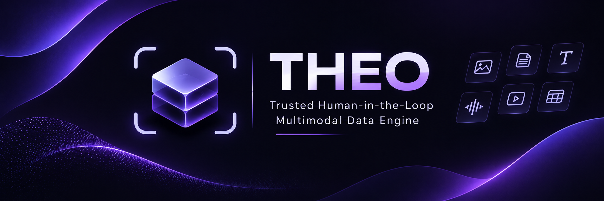

<div align="center">



# THEO

### Trusted Evidence-based Annotation and Quality Orchestration

**Turning raw multimodal data into reliable, traceable and ML-ready datasets.**

[Overview](#overview) · [Architecture](#architecture) · [Capabilities](#core-capabilities) · [Getting Started](#getting-started) · [Documentation](#documentation)

</div>

---

## Overview

THEO is a multimodal data annotation and dataset quality assurance platform designed to improve the reliability, consistency and traceability of machine learning datasets.

Preparing high-quality datasets is one of the most time-consuming stages of machine learning development. Raw data frequently contains inconsistent labels, missing information, annotation errors, ambiguous samples and undocumented transformations.

Traditional annotation workflows often treat annotation as an isolated task. They provide limited visibility into how labels were generated, why a particular decision was made, how reliable an annotation is, or whether a dataset is suitable for downstream machine learning workflows.

THEO addresses this problem by bringing annotation, validation, evaluation, human review and dataset provenance into one integrated platform.

Rather than treating generated annotations as ground truth, THEO emphasizes evidence, uncertainty, independent evaluation and human oversight.

### Design principles

* **Evidence over assumptions:** Every annotation should have an identifiable source or supporting evidence.
* **Human oversight:** Automated predictions are proposals, not unquestionable truth.
* **Transparency over false confidence:** Uncertain predictions should be surfaced rather than hidden.
* **Reproducibility:** Dataset transformations and annotation decisions should be traceable.
* **Measured quality:** Quality claims should be supported by evaluation, not arbitrary scores.
* **Modularity:** Annotation providers and modality-specific processing should remain independently extensible.

---

## Core Capabilities

THEO is designed around six data modalities.

| Modality  | Intended capabilities                                                                               |
| --------- | --------------------------------------------------------------------------------------------------- |
| Images    | Classification, object detection, segmentation and image validation                                 |
| Text      | Classification, sentiment analysis, named entity recognition and structured extraction              |
| Documents | PDF extraction, OCR, table extraction and document understanding                                    |
| Tabular   | Schema inference, profiling, missing-value analysis, duplicate detection and anomaly identification |
| Audio     | Transcription, timestamped segments, speaker diarization and sound-event analysis                   |
| Video     | Frame extraction, object tracking, temporal annotation and activity analysis                        |

Processing capabilities depend on the configured providers, model checkpoints and system dependencies.

### Annotation and validation

THEO separates annotation generation from annotation validation.

The platform is designed to support:

* Provider-based annotation generation.
* Task-specific annotation schemas.
* Structural and semantic validation.
* Evidence and provenance tracking.
* Confidence and uncertainty handling.
* Explicit annotation lifecycle states.
* Failure handling and reprocessing.

### Human-in-the-loop review

Automated annotation should not eliminate human accountability.

THEO incorporates human review workflows for:

* Approving annotations.
* Rejecting incorrect predictions.
* Correcting generated labels.
* Reviewing uncertain samples.
* Recording reviewer decisions.
* Preserving original predictions and subsequent corrections.
* Resolving annotation disagreements.

### Dataset quality and evaluation

Dataset quality is not a single number.

THEO is designed to evaluate different dimensions independently:

* Annotation coverage.
* Schema validity.
* Label consistency.
* Duplicate detection.
* Annotator agreement.
* Confidence calibration.
* Gold-standard evaluation.
* Group-wise quality analysis.
* Human correction and rejection rates.

Task-specific evaluation metrics are preferred over arbitrary combined quality scores.

### Dataset versioning and provenance

Reproducibility requires knowing exactly which data and annotations were used.

THEO uses dataset release concepts to support:

* Dataset version identification.
* Content hashing.
* Annotation snapshots.
* Release manifests.
* Quality reports.
* Annotation history.
* Provenance and audit events.
* Reproducible downstream exports.

---

## Architecture

THEO follows a modular architecture that separates application orchestration, annotation execution and quality management.

### Logical architecture

```text
                  ┌────────────────────────────┐
                  │       THEO Frontend        │
                  │     User / Review UI       │
                  └──────────────┬─────────────┘
                                 │
                                 ▼
                  ┌────────────────────────────┐
                  │       FastAPI Backend      │
                  │                            │
                  │  Authentication            │
                  │  Projects & Datasets       │
                  │  Annotation Orchestration │
                  │  Quality Management       │
                  │  Review Management        │
                  │  Dataset Releases         │
                  └──────────────┬─────────────┘
                                 │
              ┌──────────────────┼──────────────────┐
              │                  │                  │
              ▼                  ▼                  ▼
       ┌─────────────┐   ┌─────────────┐   ┌─────────────┐
       │ Annotation  │   │   Quality   │   │   Review    │
       │  Providers  │   │  Evaluation │   │   Engine    │
       └──────┬──────┘   └─────────────┘   └─────────────┘
              │
      ┌───────┼────────┬────────┬────────┬────────┐
      ▼       ▼        ▼        ▼        ▼        ▼
    Image   Text   Document  Tabular  Audio   Video

                                 │
                                 ▼
                  ┌────────────────────────────┐
                  │      Data Persistence      │
                  │                            │
                  │ PostgreSQL / SQLite        │
                  │ File and Object Storage    │
                  │ Dataset Manifests          │
                  │ Audit & Provenance Records │
                  └────────────────────────────┘
```

### Technology stack

| Layer                 | Technology                                        |
| --------------------- | ------------------------------------------------- |
| Backend               | Python, FastAPI                                   |
| Data validation       | Pydantic                                          |
| ORM                   | SQLAlchemy                                        |
| Database migrations   | Alembic                                           |
| Database              | SQLite / PostgreSQL                               |
| Background processing | Celery / Redis                                    |
| Image processing      | Pillow, OpenCV                                    |
| Computer vision       | Ultralytics YOLO                                  |
| NLP                   | Hugging Face Transformers                         |
| Document processing   | PyMuPDF, OCR integrations                         |
| Audio processing      | faster-whisper, optional diarization integrations |
| Data analysis         | Pandas, NumPy, SciPy                              |
| Frontend              | HTML, CSS, JavaScript                             |
| Deployment            | Docker, Docker Compose                            |
| Testing               | pytest                                            |
| CI                    | GitHub Actions                                    |

The frontend and backend are maintained as separate application layers, with the backend exposing APIs for application functionality.

---

## Project Structure

```text
THEO/
│
├── backend/
│   ├── app/
│   │   ├── core/
│   │   ├── domain/
│   │   ├── providers/
│   │   ├── services/
│   │   ├── security/
│   │   └── workers/
│   │
│   ├── migrations/
│   ├── tests/
│   ├── requirements.txt
│   └── requirements-ml.txt
│
├── frontend/
│
├── docs/
│
├── data/
│
├── scripts/
│
├── .github/
│
├── docker-compose.yml
├── Dockerfile
├── START_WINDOWS.bat
├── START.sh
├── README.md
├── SECURITY.md
├── LICENSE
└── .gitignore
```

---

## Getting Started

### Prerequisites

* Python 3.10 or newer.
* Git.
* Windows, Linux or macOS.
* Internet connection for initial dependency installation.

Optional capabilities may require additional system packages, model weights, GPU support or external service credentials.

### Installation

Clone the repository:

```bash
git clone https://github.com/YOUR_USERNAME/THEO.git
cd THEO
```

### Windows

The repository includes a Windows launcher:

```powershell
.\START_WINDOWS.bat
```

Alternatively, configure the environment manually:

```powershell
py -3.11 -m venv .venv

.venv\Scripts\Activate.ps1

python -m pip install --upgrade pip

pip install -r backend/requirements.txt
```

Configure the environment:

```powershell
Copy-Item .env.example .env
```

Start the backend from the project root:

```powershell
$env:PYTHONPATH = "$PWD/backend"

python -m uvicorn app.main:app --app-dir backend --host 127.0.0.1 --port 8000
```

### Linux / macOS

```bash
python3 -m venv .venv

source .venv/bin/activate

python -m pip install --upgrade pip

pip install -r backend/requirements.txt

cp .env.example .env

export PYTHONPATH="$PWD/backend"

python -m uvicorn app.main:app --app-dir backend --host 127.0.0.1 --port 8000
```

### Accessing THEO

Once the backend starts:

| Service                       | Address                     |
| ----------------------------- | --------------------------- |
| Application                   | http://127.0.0.1:8000       |
| API documentation             | http://127.0.0.1:8000/docs  |
| Alternative API documentation | http://127.0.0.1:8000/redoc |

Keep the backend process running while using the application.

### Optional machine-learning dependencies

Advanced annotation providers require additional dependencies.

```bash
pip install -r backend/requirements-ml.txt
```

Model weights are downloaded separately and are not bundled with the source repository.

Review the relevant model and provider licences before using them in commercial or redistributed applications.

---

## Quality and Scientific Evaluation

THEO treats dataset quality as a measurable engineering concern.

A model-generated prediction is not automatically a correct label. Confidence values are not equivalent to empirical accuracy.

The platform is designed to distinguish:

| Measurement                | Purpose                                                                       |
| -------------------------- | ----------------------------------------------------------------------------- |
| Precision                  | Measures the correctness of positive predictions                              |
| Recall                     | Measures how many relevant instances are identified                           |
| F1 score                   | Balances precision and recall                                                 |
| IoU                        | Measures overlap for spatial annotations                                      |
| Cohen's kappa              | Measures agreement between two annotators beyond chance                       |
| Krippendorff's alpha       | Measures agreement across annotators under supported measurement conditions   |
| Expected Calibration Error | Evaluates the relationship between confidence and empirical correctness       |
| Coverage                   | Measures how much of a dataset has been annotated or reviewed                 |
| Abstention rate            | Measures how frequently the system declines to produce a confident annotation |

Gold-standard evaluation requires independently verified reference labels.

Group-wise quality analysis should only use appropriate, ethically collected group information. Automated analysis cannot independently establish fairness or eliminate bias.

---

## Relationship with SentinelML

THEO is designed to complement, not replace, SentinelML.

The two projects address different stages of the machine-learning lifecycle.

| Responsibility             | THEO | SentinelML |
| -------------------------- | ---- | ---------- |
| Dataset ingestion          | Yes  | —          |
| Multimodal annotation      | Yes  | —          |
| Human annotation review    | Yes  | —          |
| Dataset quality evaluation | Yes  | —          |
| Dataset releases           | Yes  | —          |
| Model training             | —    | Yes        |
| Model evaluation           | —    | Yes        |
| Model quality gates        | —    | Yes        |
| Model deployment           | —    | Yes        |
| Model monitoring           | —    | Yes        |

### Intended integration workflow

```text
Raw Data
   │
   ▼
  THEO
   │
   ├── Annotation
   ├── Validation
   ├── Human Review
   ├── Quality Evaluation
   └── Dataset Release
          │
          ▼
     Dataset Export
          │
          ▼
     SentinelML
          │
          ├── Model Training
          ├── Model Evaluation
          ├── Quality Gates
          ├── Model Registration
          └── Model Monitoring
```

THEO remains independently usable. SentinelML integration is an optional downstream workflow.

---

## Configuration and Security

Never commit secrets, passwords, API keys, access tokens or private dataset contents.

Before deploying THEO beyond a local development environment:

* Configure strong application secrets.
* Use appropriate authentication and authorization.
* Restrict upload types and file sizes.
* Validate uploaded files.
* Configure secure database credentials.
* Use HTTPS.
* Apply appropriate storage permissions.
* Review model and dependency licences.
* Configure backups and retention policies.
* Review the security implications of external model providers.

See [SECURITY.md](SECURITY.md) for vulnerability reporting and security practices.

---

## Testing

Run backend tests from the project root:

```bash
pytest backend/tests -v
```

Tests should cover:

* Dataset ingestion.
* Annotation provider contracts.
* Schema validation.
* Annotation state transitions.
* Human review decisions.
* Dataset release integrity.
* Quality evaluation.
* API authorization.
* Export correctness.
* Failure and recovery scenarios.

A successful test suite does not independently establish production readiness or scientific validity.

---

## Documentation

Project documentation is maintained in the `docs/` directory.

Recommended documentation areas include:

| Document                      | Purpose                                      |
| ----------------------------- | -------------------------------------------- |
| Architecture                  | System boundaries and design decisions       |
| Data Model                    | Entities, relationships and constraints      |
| API Specification             | API contracts and request/response behaviour |
| Annotation Standards          | Modality-specific annotation conventions     |
| Quality Methodology           | Metrics, evaluation and limitations          |
| Testing Strategy              | Testing levels and acceptance criteria       |
| Threat Model                  | Security boundaries and risks                |
| Roadmap                       | Planned development and milestones           |
| Architecture Decision Records | Important engineering decisions              |

---

## Roadmap

THEO is intended to evolve into a robust, extensible annotation and dataset quality platform.

Development priorities:

* [ ] Complete and validate all modality-specific annotation pipelines.
* [ ] Expand provider support and provider contract tests.
* [ ] Improve evidence-backed semantic validation.
* [ ] Establish reproducible gold-standard benchmarks.
* [ ] Improve confidence calibration and abstention policies.
* [ ] Expand human review and multi-annotator adjudication.
* [ ] Strengthen immutable dataset release guarantees.
* [ ] Improve distributed processing and recovery.
* [ ] Complete production-grade authorization and security hardening.
* [ ] Expand observability and operational monitoring.
* [ ] Implement and test the SentinelML integration.
* [ ] Improve frontend usability and accessibility.
* [ ] Add deployment and performance testing.

---

## Contributing

Contributions, issues and engineering discussions are welcome.

For meaningful changes:

1. Open an issue describing the problem or proposed enhancement.
2. Discuss architectural implications where relevant.
3. Create a feature branch.
4. Implement the change with appropriate tests.
5. Update relevant documentation.
6. Submit a pull request describing the design and verification performed.

Suggested branch naming:

```text
feature/annotation-provider
feature/dataset-versioning
fix/annotation-validation
docs/architecture-update
```

Suggested commit conventions:

```text
feat: add image annotation provider
fix: validate annotation offsets
test: add dataset release integrity tests
docs: document provider architecture
refactor: isolate annotation orchestration
```

---

## Licence

This project is distributed under the licence specified in the repository's `LICENSE` file.

Review the licences of individual model checkpoints, pretrained weights and third-party dependencies separately. The repository licence does not automatically grant redistribution rights to external model assets.

---

<div align="center">

**THEO**

*Evidence over assumptions. Quality over convenience.*

Built to make dataset preparation more transparent, reproducible and reliable.

</div>
