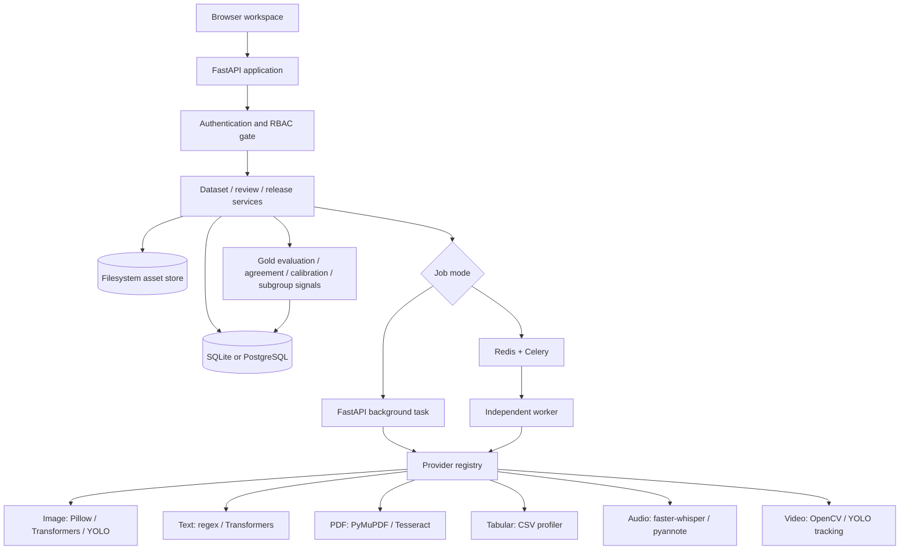

# THEO architecture

## System intent

THEO is a multimodal data annotation and quality orchestration platform. It owns dataset ingestion, model-assisted proposals, evidence/provenance, human review, gold-reference evaluation, immutable dataset releases and interoperable exports. It deliberately does not own model training, deployment or model lifecycle monitoring; those responsibilities remain with systems such as SentinelML.

## Runtime topology

## Architectural style

The application is a modular monolith with independently executable workers. It avoids one microservice per modality while keeping provider-specific dependencies outside the core domain. The API layer validates requests and orchestrates domain workflows; services implement evaluation and quality logic; providers implement modality processing behind a stable proposal contract.

## Provider contract

A provider declares its name, supported modality and `annotate(sample, file_path)` method. It returns a `Proposal` containing a structured label, optional provider-reported score, evidence, review status and provider identity. Providers must expose limitations and model references. They must never silently convert an inference failure into a confident label. All proposals require review by default.

Modality schemas are intentionally not flattened into one generic label structure. Image boxes/masks, text offsets, PDF page references, audio segments, video tracks and tabular profiles have different validation requirements.

## Processing lifecycle

1. Validate dataset modality, file extension, upload size and content hash.
2. Store original bytes separately from relational metadata.
3. Create a processing-job row before dispatch.
4. Run the selected modality provider in local or Celery mode.
5. Persist the original proposal, provider identity/version, evidence and audit events.
6. Route proposals to human review; record each review decision and any correction.
7. Curate independent gold labels and evaluate approved predictions against them.
8. Create a release only when annotations are resolved; snapshot labels, gold references, source hashes and quality report.
9. Freeze released data through application workflows. Clone to make a new working copy.

## Persistence and migrations

- SQLite is the zero-configuration local default.
- PostgreSQL is used by the Docker Compose profile.
- Original assets and generated exports live outside SQL tables.
- Alembic migration scripts live in `backend/migrations`.
- `Base.metadata.create_all` remains enabled for frictionless local bootstrap; use Alembic for controlled schema evolution and deployed databases.

## Job execution

Local mode uses FastAPI background tasks and is intended for single-process development. Docker Compose enables Redis/Celery with a separate worker. Celery tasks acknowledge late and use retry semantics. Job processing is idempotent at the sample level: existing annotation records are skipped. Production operations still need queue monitoring, dead-letter/recovery policy, worker resource limits and load testing.

## Security boundaries

- Passwords use salted scrypt hashes.
- Bearer tokens use HS256 signatures and expirations; `THEO_JWT_SECRET` must be random and secret.
- The first account bootstraps as administrator; later accounts are provisioned by an admin.
- Docker Compose enables the API-wide auth gate and role restrictions.
- Local launcher is loopback-oriented and leaves auth optional for convenient development.
- Public deployment requires HTTPS, hardened reverse proxy, network restrictions, secrets management, upload scanning, backups and operational monitoring.

## Known architectural boundaries

- Filesystem storage is the default asset adapter; it is not highly available object storage.
- No multi-tenant organization isolation or external identity provider integration is implemented.
- Optional ML providers need checkpoint/version pinning and dedicated resource-isolated workers for production.
- Generic classification evaluation does not replace detection/segmentation/NER/audio/video task-specific benchmarks.
- Application-level release immutability does not prevent privileged database/storage tampering.
