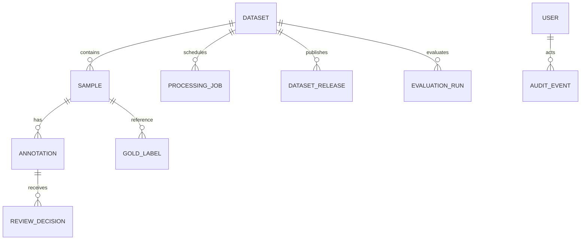

# Data model

## Dataset

Named collection with one modality, task, optional schema, description and timestamps. A dataset with a release is frozen through API write paths. A clone creates a new editable dataset and copies source assets by reference, preserving gold labels while resetting annotations to review-required.

## Sample

An uploaded asset with dataset ownership, display filename, MIME hint, byte count, SHA-256, storage path, extracted text and metadata. Original bytes are kept outside SQL. Multiple cloned samples may reference the same immutable content path; deletion only removes the file when no sample references it.

## Annotation

Provider proposal or reviewed result. Stores current label, original label, status, provider/version, optional reported confidence, evidence, reviewer identity/note and timestamps. Confidence is not accuracy. Corrections never overwrite the original proposal.

## ReviewDecision

Append-oriented decision record with annotation, reviewer, decision, label snapshot, note and timestamp. Adjudication is recorded separately from ordinary review decisions.

## GoldLabel

Independently verified reference label associated with a sample and task. Stores verifier identity and annotation-guideline version. A unique constraint prevents duplicate reference labels for the same sample/task. Gold labels are included in release manifests.

## EvaluationRun

Persisted evaluation metadata and result. Stores dataset, evaluation type, reference version, parameters and metrics. The gold-evaluation endpoint compares approved annotation values with explicit verified reference labels and records excluded samples and guideline versions.

## ProcessingJob

UUID-backed job record with queue status, progress, result, error and lifecycle timestamps. Supports local background mode and optional Celery/Redis dispatch.

## DatasetRelease

Versioned manifest, quality snapshot and SHA-256 content hash. The manifest records source sample hashes, annotation state, original/current labels, provider identity, evidence, human reviewer metadata and gold references.

## User

Unique username, scrypt password hash, active flag and role (`admin`, `reviewer`, `viewer`). The first account is administrator; account creation thereafter requires an administrator token.

## AuditEvent

Append-oriented action record with entity, actor, structured detail and timestamp. It provides application traceability but is not a tamper-proof compliance ledger.
